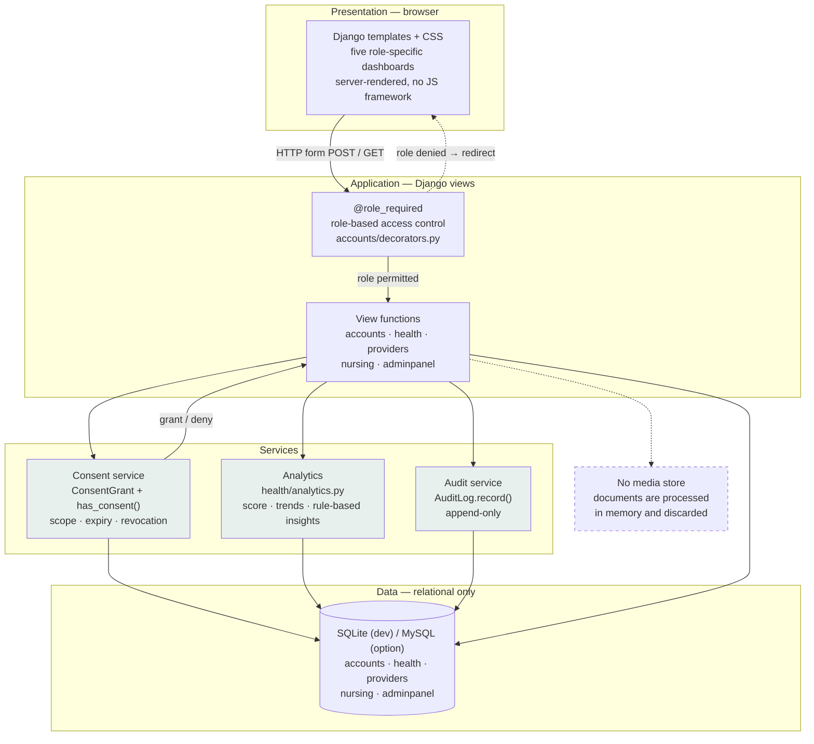
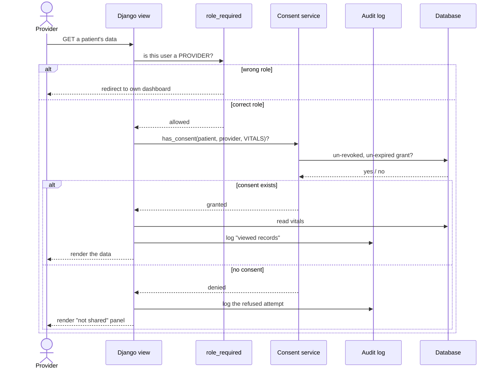

# CareNest — System Architecture

**Task 2.7** · Describes the system as built on 2026-08-03.

> **Changes from the pre-build architecture diagram:** the intelligence layer
> no longer contains a drug-interaction checker (removed from scope after
> review feedback). The data layer contains **no media store** — uploaded
> documents are processed and discarded, so there is nothing to store. A
> consent service and an append-only audit log were added.

---

## Layered view

---

## Request path for a consent-gated read

The clearest way to understand the architecture is to follow one request: a
provider opening a patient's records.

Two properties of this flow are worth stating explicitly in the report:

The consent check is **separate from** the role check. Being a provider gets
you to the page; only a live consent grant from that specific patient gets
you the data. Having an appointment with someone is not authorisation to read
their records.

Refusals are logged as well as grants. An audit trail that records only
successful access cannot tell you whether anyone tried and failed, which is
exactly the thing a privacy audit needs to know.

---

## Layer responsibilities

| Layer | Holds | Deliberately does not hold |
|---|---|---|
| Presentation | Templates, CSS, minimal vanilla JS | Business rules, permission checks |
| Application | View functions, role gating, form handling | SQL, threshold constants |
| Services | Consent decisions, analytics rules, audit writes | HTTP concerns, template markup |
| Data | Relational tables only | Uploaded files, media, binary blobs |

The analytics thresholds live in exactly one place (`health/analytics.py`) and
are imported wherever needed rather than repeated, so changing the definition
of a high blood-pressure reading is a one-line change with no risk of two
parts of the system disagreeing.

---

## Technology choices and why

| Layer | Choice | Reason |
|---|---|---|
| Language | Python 3.11 | One language across the web application and the data-science work |
| Framework | Django 5.2 (MVT) | Auth, ORM, migrations, admin and a test client without assembling them |
| Database | SQLite; MySQL supported | Zero setup for a demo. `USE_SQLITE=0` switches to MySQL with no code change |
| Frontend | Django templates + CSS | No build step, no npm, nothing to break during a viva |
| Charts | Server-computed SVG polylines | Real data, no chart library, no client-side dependency |
| Auth | Django's built-in `auth` | Battle-tested password hashing and session handling; writing our own would be a security liability |
| Testing | Django test framework | Same client the app runs on |

---

## Deployment shape

Single Django process behind the development server locally, or WSGI in
production. No message queue, no cache layer, no separate API service. At the
scale of this project those would be complexity without benefit — and each
one is a component that can fail during a demonstration.
