# CareNest — Entity Relationship Diagram

**Task 2.6** · Generated from the actual Django models on 2026-08-03, not from
the pre-build design. Every entity, field and relationship below exists in
`accounts/models.py`, `health/models.py`, `providers/models.py`,
`nursing/models.py` and `adminpanel/models.py`.

> **If you are updating an older ERD:** six entities did not exist when the
> original diagram was drawn — `MedicationDose`, `ConsentGrant`,
> `HealthInsight`, `NurseAssignment`, `NursingVisit` and `AuditLog`. The
> `DrugInteraction` entity and all media/document-storage entities were
> removed from the design and never built.

---

## Diagram

```mermaid
erDiagram
    USER ||--o{ CAREGIVERLINK : "is the patient in"
    USER ||--o{ CAREGIVERLINK : "is the caregiver in"
    USER ||--o{ VITALRECORD : "owns"
    USER ||--o{ VITALRECORD : "entered (entered_by)"
    USER ||--o{ MEDICATION : "owns"
    USER ||--o{ LIFESTYLELOG : "owns"
    USER ||--o{ MOODLOG : "owns (private)"
    USER ||--o{ CONSENTGRANT : "grants"
    USER ||--o{ CONSENTGRANT : "receives"
    USER ||--o{ HEALTHINSIGHT : "has"
    USER ||--o| PROVIDERPROFILE : "has (providers only)"
    USER ||--o{ APPOINTMENT : "books"
    USER ||--o{ NURSEASSIGNMENT : "is the nurse in"
    USER ||--o{ NURSEASSIGNMENT : "is the patient in"
    USER ||--o{ NURSINGVISIT : "is the nurse in"
    USER ||--o{ NURSINGVISIT : "is the patient in"
    USER ||--o{ AUDITLOG : "acted as"

    MEDICATION     ||--o{ MEDICATIONDOSE : "is ticked off in"
    PROVIDERPROFILE||--o{ APPOINTMENT    : "receives"
    VITALRECORD    ||--o| NURSINGVISIT   : "was taken during"

    USER {
        int      id                PK
        string   username          UK "email is used as the username"
        string   password
        string   email
        string   first_name
        string   last_name
        string   role                  "PATIENT | CAREGIVER | PROVIDER | ADMIN | NURSE"
        string   unique_id         UK  "10-char CareNest ID, auto-generated"
        string   phone_number
        date     date_of_birth
        string   sex                   "F | M | O"
        string   blood_group
        int      height_cm
        string   address
        string   emergency_contact
        bool     is_suspended          "admin can disable without deleting"
        bool     is_staff
        bool     is_superuser
        datetime date_joined
    }

    CAREGIVERLINK {
        int      id           PK
        int      patient_id   FK
        int      caregiver_id FK
        string   relationship
        string   status           "PENDING | APPROVED | REJECTED"
        datetime requested_at
        datetime decided_at
    }

    VITALRECORD {
        int      id            PK
        int      patient_id    FK
        datetime recorded_at
        int      bp_systolic
        int      bp_diastolic
        decimal  blood_sugar
        decimal  weight_kg
        int      heart_rate
        string   status            "NORMAL | WATCH | HIGH - computed on save"
        string   source            "SELF | NURSE | CAREGIVER - provenance"
        int      entered_by_id FK  "null when self-recorded"
    }

    MEDICATION {
        int    id               PK
        int    patient_id       FK
        string name
        string dose
        string schedule
        date   start_date
        date   next_refill_date
        bool   active
    }

    MEDICATIONDOSE {
        int      id            PK
        int      medication_id FK
        date     date              "unique together with medication"
        bool     taken
        datetime taken_at
    }

    LIFESTYLELOG {
        int     id            PK
        int     patient_id    FK
        date    date              "unique together with patient"
        decimal sleep_hours
        decimal water_litres
        int     steps
        string  activity_note
    }

    MOODLOG {
        int    id         PK
        int    patient_id FK
        date   date
        string mood
        text   note           "NEVER shareable - see note below"
    }

    CONSENTGRANT {
        int      id                PK
        int      patient_id        FK
        int      recipient_id      FK
        bool     scope_vitals
        bool     scope_medications
        bool     scope_records
        bool     scope_lifestyle
        datetime granted_at
        datetime expires_at            "null = ongoing grant"
        datetime revoked_at            "null = not withdrawn"
        string   action_context        "why the grant was made"
        string   passcode              "auto-generated share code"
    }

    HEALTHINSIGHT {
        int      id         PK
        int      patient_id FK
        string   level          "INFO | WARNING | CRITICAL"
        string   text
        string   evidence       "the data that triggered the rule"
        datetime created_at
    }

    PROVIDERPROFILE {
        int      id                          PK
        int      user_id                     FK "OneToOne"
        string   provider_type                  "DOCTOR | CLINIC | HOSPITAL | DIAGNOSTIC_LAB | PHARMACY | DIETICIAN | FITNESS_CENTRE | WELLNESS_CENTRE"
        string   specialty
        int      years_experience
        string   clinic_name
        string   address
        string   registration_number
        bool     doc_registration_certificate
        bool     doc_government_id
        bool     doc_organization_info
        bool     doc_address_proof
        string   verification_status            "PENDING | VERIFIED | NEEDS_INFO"
        string   verification_note
        datetime submitted_at
        datetime verified_at
    }

    APPOINTMENT {
        int      id            PK
        int      patient_id    FK
        int      provider_id   FK
        datetime scheduled_for
        string   reason
        string   status            "REQUESTED | CONFIRMED | COMPLETED | DECLINED | CANCELLED"
        text     provider_note
        datetime created_at
    }

    NURSEASSIGNMENT {
        int    id             PK
        int    nurse_id       FK
        int    patient_id     FK
        date   start_date
        date   end_date           "null while ongoing"
        int    assigned_by_id FK  "the admin who created it"
        string notes
    }

    NURSINGVISIT {
        int      id                       PK
        int      nurse_id                 FK
        int      patient_id               FK
        datetime visited_at
        text     notes
        string   medications_administered
        int      vitals_id                FK "the VitalRecord taken during the visit"
        bool     escalated
        string   severity                    "ROUTINE | URGENT"
        string   escalation_reason
    }

    AUDITLOG {
        int      id          PK
        int      actor_id    FK "nullable - survives user deletion"
        string   actor_label    "denormalised name, kept if the user is removed"
        string   action
        string   target
        string   tag            "ok | warn | danger | muted"
        datetime created_at
    }
```

---

## Design notes a reader will ask about

**Why one `User` table for five roles.** The system uses a single-table role
discriminator (`User.role`) rather than separate tables or model inheritance
per role. Every role shares the same identity, authentication and profile
fields; only permissions and available screens differ, and those are enforced
at the view layer by `accounts/decorators.py`. Adding a sixth role is a
one-line change to a `TextChoices` class, not a schema migration.

**Why `ProviderProfile` is a separate one-to-one.** Provider-specific fields
(verification status, documents, registration number) apply to roughly one
role. Putting sixteen nullable columns on `User` to serve one role would make
every other role's rows mostly empty. A one-to-one keeps `User` clean.

**Why `MoodLog` has no relationship to `ConsentGrant`.** This is deliberate
and it is the single most important thing on this diagram. `ConsentGrant` has
four scope booleans — vitals, medications, records, lifestyle — and there is
no fifth for mental health. There is no combination of consent settings that
grants anyone access to `MoodLog`. The exclusion is enforced by the absence
of a code path, not by a default setting that could be changed by mistake.

**Why `VitalRecord` carries `source` and `entered_by`.** The nursing design
document asked whether nurse-recorded vitals should live in a separate table.
They do not: a blood-pressure reading is the same clinical fact whoever took
it, so splitting the table would mean every query had to union two sources.
Instead the row is provenance-tagged, so a nurse-taken reading during a home
visit is distinguishable from a patient's self-entry without duplicating the
schema.

**Why `MedicationDose` exists separately from `Medication`.** `Medication`
describes a prescription; `MedicationDose` records one day's adherence
against it. Keeping them separate is what makes an adherence percentage
computable, and it is the input to the non-adherence model planned in
Phase 5. The `unique_together` on `(medication, date)` prevents double-ticking.

**Why `AuditLog.actor_label` duplicates the user's name.** The foreign key is
nullable and set to `SET_NULL` on delete, so that removing a user does not
erase the audit trail. The denormalised label preserves who acted even after
the account is gone. An audit log that can be emptied by deleting a user is
not an audit log.
