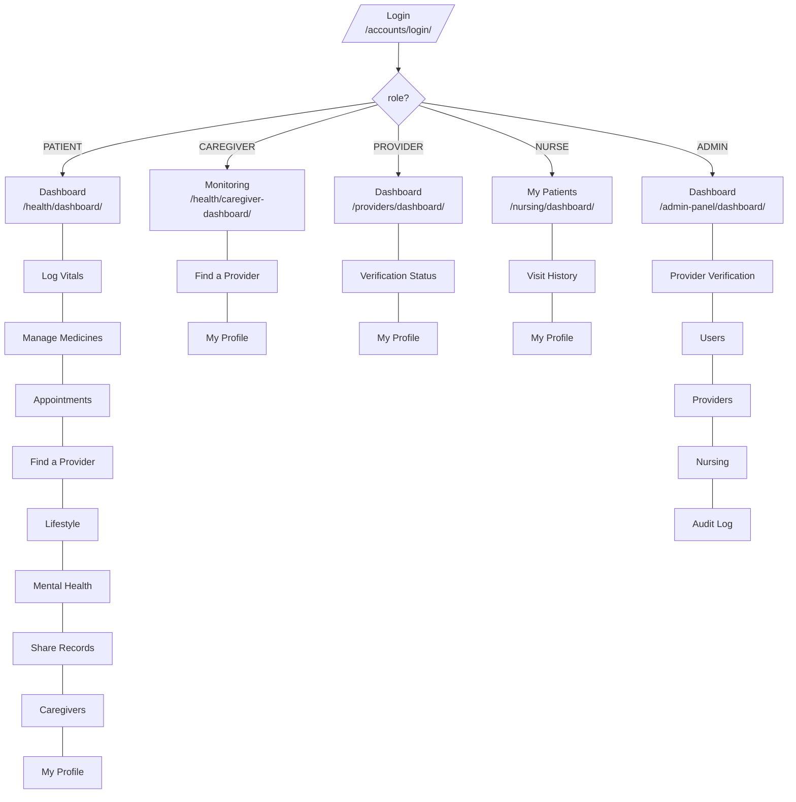

# CareNest — Information Architecture

**Task 2.12** · Role-based navigation map. Derived from the five sidebar
partials in `templates/partials/` and the URL configuration, on 2026-08-03.

Each role sees only its own navigation. A user who types another role's URL
is redirected to their own home by `@role_required`, so navigation and
permission agree — the menu is not merely hiding links that would otherwise
work.

---

## Navigation map

---

## Per-role sidebar

### Patient — 10 items
| Label | URL name | Path |
|---|---|---|
| Dashboard | `health_dashboard` | `/health/dashboard/` |
| My Profile | `profile` | `/accounts/profile/` |
| Log Vitals | `health_vitals` | `/health/vitals/` |
| Manage Medicines | `health_medications` | `/health/medications/` |
| Appointments | `provider_appointments` | `/providers/appointments/` |
| Find a Provider | `provider_directory` | `/providers/directory/` |
| Lifestyle | `health_lifestyle` | `/health/lifestyle/` |
| Mental Health | `health_mental_health` | `/health/mental-health/` |
| Share Records | `health_share` | `/health/share/` |
| Caregivers | `health_caregiver_requests` | `/health/caregiver-requests/` |

### Caregiver — 3 items
| Label | URL name | Path |
|---|---|---|
| Monitoring | `health_caregiver_dashboard` | `/health/caregiver-dashboard/` |
| Find a Provider | `provider_directory` | `/providers/directory/` |
| My Profile | `profile` | `/accounts/profile/` |

### Provider — 3 items
| Label | URL name | Path |
|---|---|---|
| Dashboard | `provider_dashboard` | `/providers/dashboard/` |
| Verification Status | `provider_pending` | `/providers/pending/` |
| My Profile | `profile` | `/accounts/profile/` |

### Nurse — 3 items
| Label | URL name | Path |
|---|---|---|
| My Patients | `nurse_dashboard` | `/nursing/dashboard/` |
| Visit History | `nurse_visits` | `/nursing/visits/` |
| My Profile | `profile` | `/accounts/profile/` |

### Admin — 6 items
| Label | URL name | Path |
|---|---|---|
| Dashboard | `admin_dashboard` | `/admin-panel/dashboard/` |
| Provider Verification | `admin_verification` | `/admin-panel/verification/` |
| Users | `admin_users` | `/admin-panel/users/` |
| Providers | `admin_providers` | `/admin-panel/providers/` |
| Nursing | `admin_nursing` | `/admin-panel/nursing/` |
| Audit Log | `admin_audit_log` | `/admin-panel/audit-log/` |

Every sidebar also carries an Emergency shortcut and Log out below a
separator.

---

## Design decisions

**Depth is one level.** No role has a nested menu. Every screen is one click
from the sidebar. The target users include elderly and low-technology
patients, for whom a hidden second level is a screen they will never find.

**The caregiver's navigation is deliberately small.** Three items, because a
caregiver's job is to check on someone, not to manage a system. Giving them
the patient's ten-item menu would imply capabilities they do not have.

**Patients get the widest menu, and that is a risk.** Ten items is at the
upper limit for this audience. The ordering puts daily actions — vitals,
medicines — directly under the dashboard, and administrative items — sharing,
caregivers, profile — lower. If usability testing in Phase 6 shows people
losing their way, the fix is grouping, not adding a second level.

**The patient's CareNest ID is in the sidebar, not buried in the profile.**
Linking a caregiver requires reading that ID aloud over the phone, so it sits
where it can be found without navigating anywhere.

**Two different admin surfaces exist and are never mixed.** `/admin/` is
Django's developer tool for inspecting tables. `/admin-panel/` is the Admin
*role's* product interface. They are separate URLs, separate templates and
separate mental models.
