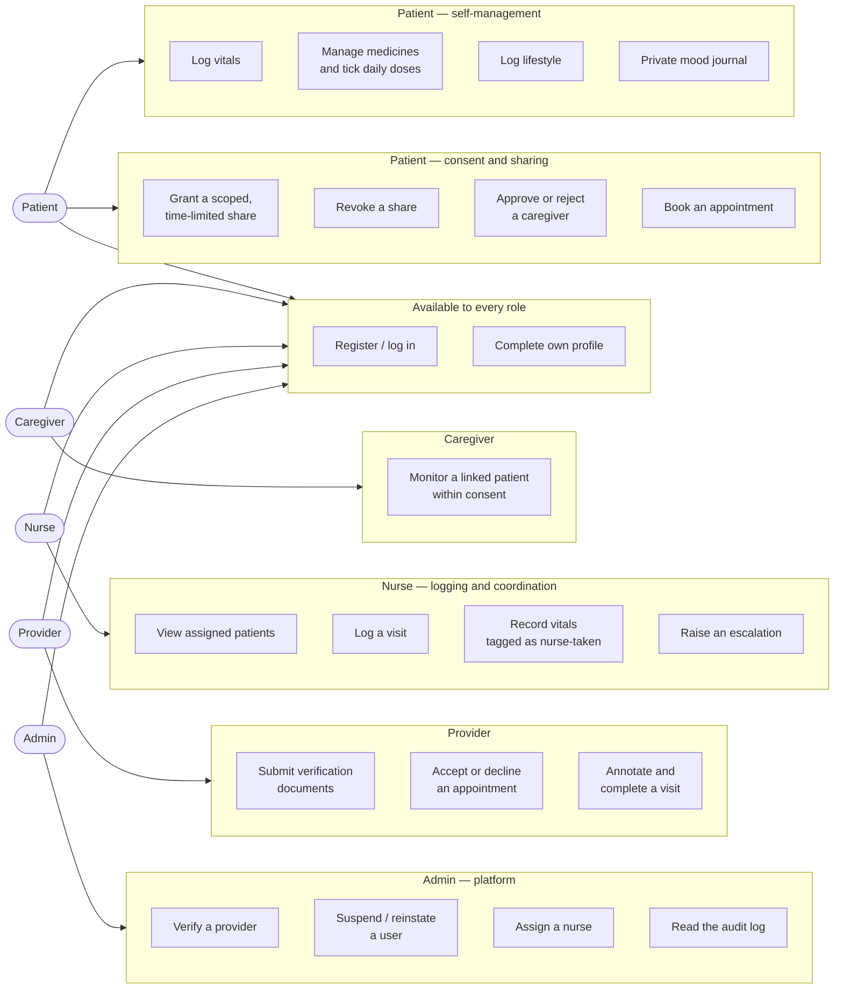

# CareNest — Use Cases

**Tasks 2.5 and 2.8** · Five actors. Every use case marked *implemented*
corresponds to a URL that exists in the running system on 2026-08-03.

> **Change from the pre-build diagram:** the original use-case set was
> patient-heavy, which was a criticism at review. Provider and nurse cases
> now account for a substantial share, and the Admin is a real actor with
> its own workflows rather than a database operator.

---

## Actor diagram

---

## Implemented use cases

| # | Actor | Use case | Where it lives |
|---|---|---|---|
| 1 | Patient | Register and reach the dashboard immediately | `/accounts/register/` |
| 2 | Patient | Complete profile progressively | `/accounts/profile/` |
| 3 | Patient | Log a vitals reading, auto-flagged Normal / Watch / High | `/health/vitals/` |
| 4 | Patient | Add a medicine and tick off each daily dose | `/health/medications/` |
| 5 | Patient | Log sleep, water, steps and activity | `/health/lifestyle/` |
| 6 | Patient | Keep a private mood journal | `/health/mental-health/` |
| 7 | Patient | Grant a scoped, time-limited record share | `/health/share/` |
| 8 | Patient | Revoke a share, effective immediately | `/health/share/` |
| 9 | Patient | Approve or reject a caregiver's link request | `/health/caregiver-requests/` |
| 10 | Patient | Browse verified providers | `/providers/directory/` |
| 11 | Patient | Request and cancel appointments | `/providers/appointments/` |
| 12 | Caregiver | Request access using a patient's CareNest ID | `/health/caregiver-link/` |
| 13 | Caregiver | Monitor a linked patient, within consent | `/health/caregiver-dashboard/` |
| 14 | Provider | Register and submit verification documents | `/providers/pending/` |
| 15 | Provider | Resubmit after an information request | `/providers/pending/` |
| 16 | Provider | Accept or decline appointment requests | `/providers/dashboard/` |
| 17 | Provider | Annotate and complete a visit | `/providers/dashboard/` |
| 18 | Nurse | See assigned patients and their latest readings | `/nursing/dashboard/` |
| 19 | Nurse | Log a visit, with vitals tagged as nurse-recorded | `/nursing/patient/<id>/log-visit/` |
| 20 | Nurse | Raise an escalation with a severity | `/nursing/patient/<id>/log-visit/` |
| 21 | Nurse | Review visit history | `/nursing/visits/` |
| 22 | Admin | Work the provider verification queue | `/admin-panel/verification/` |
| 23 | Admin | Search, suspend and reinstate users | `/admin-panel/users/` |
| 24 | Admin | Promote a user to Nurse | `/admin-panel/users/` |
| 25 | Admin | Assign a nurse to a patient | `/admin-panel/nursing/` |
| 26 | Admin | Review nursing escalations | `/admin-panel/nursing/` |
| 27 | Admin | Read the append-only audit log | `/admin-panel/audit-log/` |
| 28 | Admin | See live platform KPIs | `/admin-panel/dashboard/` |

## Planned use cases

Not yet built. Each is scheduled in the phase-wise completion plan.

| Actor | Use case | Phase |
|---|---|---|
| Patient | Upload a prescription and confirm the extracted medicines | 2 |
| Patient | Share a pre-visit snapshot ahead of an appointment | 3 |
| Provider | Open a consented pre-visit snapshot | 3 |
| Provider | Set a care plan with measurable targets | 3 |
| Provider | Publish weekly availability | 3 |
| Provider | Review a remote-monitoring dashboard | 4 |
| Nurse | Receive routed alerts for assigned patients | 4 |
| Patient | See ranked, explained recommendations | 5 |

---

## Two use cases in detail

The report needs at least a couple of use cases expanded. These two carry the
most design weight.

### UC-7 · Patient grants a record share

**Actor:** Patient · **Precondition:** the recipient is a verified provider or
an approved caregiver.

1. Patient opens Share Records.
2. System lists eligible recipients — verified providers and approved
   caregivers only. Nobody else can be selected.
3. Patient chooses categories: vitals, medications, records, lifestyle.
   Mental health is shown but permanently disabled, with the reason stated.
4. Patient chooses an expiry: 2 hours, 24 hours, 7 days, or ongoing.
5. System creates a `ConsentGrant`, generates a passcode, and writes an audit
   entry.
6. The recipient can now see exactly the chosen categories, and only until
   the expiry.

**Alternate flow — revocation:** the patient revokes at any time. The grant's
`revoked_at` is set rather than the row being deleted, the audit log records
the withdrawal, and access stops on the recipient's next request. Both the
grant and its withdrawal remain visible in the trail.

### UC-20 · Nurse raises an escalation

**Actor:** Nurse · **Precondition:** an active `NurseAssignment` links the
nurse to the patient.

1. Nurse opens an assigned patient. A nurse who is not assigned to that
   patient receives a 404 — assignment is the authorisation.
2. Nurse records vitals taken during the visit. These are written to the
   shared `VitalRecord` table with `source=NURSE` and `entered_by` set, so
   the reading is distinguishable from a patient self-entry without being
   held in a separate table.
3. Nurse writes visit notes and any medicines administered.
4. Nurse ticks *escalate* and gives a reason. Severity becomes `URGENT`.
5. System writes an audit entry and surfaces the escalation to the Admin.

**Boundary:** a nurse can record observations and request attention. A nurse
cannot prescribe, change a medicine, or alter a care plan — those remain
provider actions. There is deliberately no view in the `nursing` app that
writes to `Medication`.
